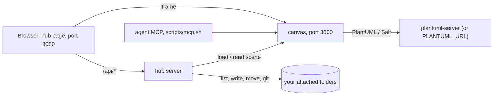
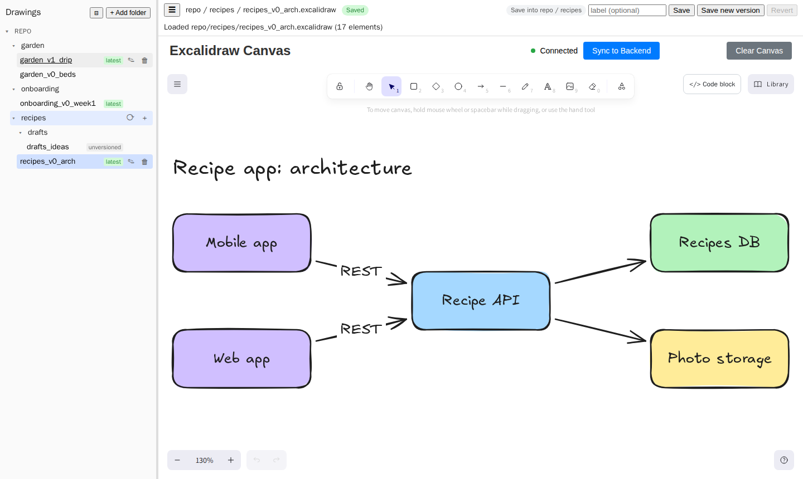
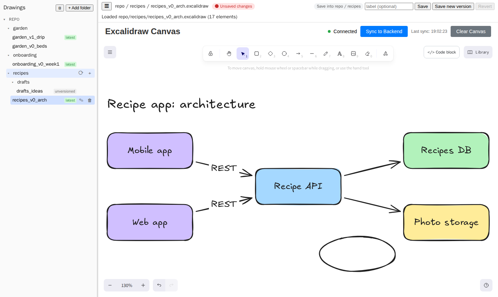
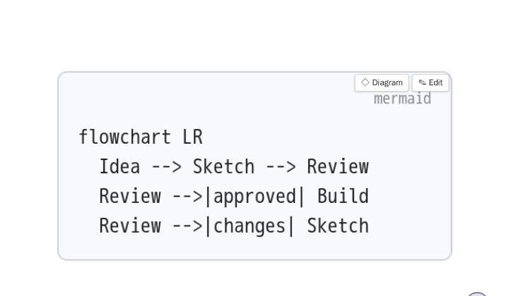

# Excalidraw hub

A local web page that puts an Excalidraw canvas next to a file explorer for your drawings. Attach any folder on your machine and the explorer shows its subfolders and `.excalidraw` files, like the VS Code sidebar. Click a drawing to load it, save, save a new version, revert, rename, move by drag and drop, and commit and push a folder's drawings to git. A badge shows when the canvas has unsaved changes.

The canvas is the same one an AI agent's Excalidraw MCP talks to, so you and the agent see one drawing. The canvas also renders Mermaid, PlantUML and Salt code blocks.



Made-up demo data in the screenshots, regenerated with `scripts/screenshots.sh`.


*The explorer: one top node per attached folder, subfolders at any depth, the highest version of each drawing marked "latest", off-scheme files "unversioned". Hovering a drawing shows rename and delete; hovering a folder shows new folder and, inside a git repo, sync.*


*Any real edit turns the badge to "Unsaved changes".*


*Code blocks: paste Mermaid, PlantUML or Salt text and it is rendered on the canvas.*


*Hover a code block to switch between diagram and source, or edit it.*

## Install
Pick one way. Both use the same two ports (hub 3080, canvas 3000, changeable under [Configure](#configure)), so run only one at a time. The ports must be free. Everything below is run from the clone:
```bash
git clone https://github.com/turtlewizard73/excalidraw-hub.git
cd excalidraw-hub
```

### With Docker
Needs Docker with Compose v2 (2.20 or later). No Node needed.
```bash
cp .env.example .env     # then edit UID and GID in .env to the output of `id -u` and `id -g` (1000 is usual)
touch ~/.gitconfig && mkdir -p ~/.ssh     # compose mounts both; Docker would create missing ones as root-owned folders
docker compose up -d --build
```
The first build takes a few minutes. Then open http://localhost:3080 (the canvas shows "Loading canvas" for a few seconds before "Connected"). You see the header "Drawings" and a note "No folders yet" with an "+ Add folder" button; continue with [Use](#use). The hub and canvas start with Docker and restart after a crash. Stop everything with `docker compose down`. Compose names the stack after the clone's folder, so two clones in folders with the same name (for example two `excalidraw-hub` folders) share one stack: give a second clone another folder name.

What Docker mounts into the hub container (read-write unless noted), all at the same path as on your machine:
- `FOLDERS_ROOT` (default your home folder): only folders inside it can be attached. Set it narrower, such as `/home/me/repos`, to limit what the container can write. The canvas container gets the same mount, so an agent's file exports land where your drawings are. While `FOLDERS_ROOT` is empty or unreadable the hub exits and Docker restarts it (this waits out Docker Desktop connecting the mount after a reboot), so `FOLDERS_ROOT` must hold at least one entry; until then http://localhost:3080 refuses connections.
- Git remotes given as a local path (such as a bare repo `/home/me/backup.git`) must also lie inside `FOLDERS_ROOT`, or sync cannot reach them from the container. SSH and HTTPS remotes need nothing extra.
- `./config` (the state file) and `BACKUPS_DIR` (copies for Revert).
- `~/.gitconfig` and `~/.ssh`, read-only, so sync commits as you and pushes with your SSH key. The key needs no passphrase, because there is no ssh agent in the container.

### Without Docker
Needs Node.js 20 or newer (with npm), git and curl, on Linux or WSL.
```bash
cp .env.example .env         # optional here: set ports or FOLDERS_ROOT (UID/GID are Docker-only)
scripts/native.sh install    # once, and after canvas/ changes: npm ci + build of the canvas
scripts/native.sh start      # canvas and hub in the background; logs and pids in .native/
scripts/native.sh status     # or: stop, restart
```
Open http://localhost:3080. It does not start at boot, and `start` refuses a busy port. Sync uses your own git identity and ssh agent. After editing `.env`, run `scripts/native.sh restart`. More in [docs/setup.md](docs/setup.md).

PlantUML and Salt code blocks need a renderer: under Docker one starts by default; without Docker set `PLANTUML_URL` ([docs/setup.md](docs/setup.md#diagram-renderers)). Mermaid works either way.

## Configure
Settings live in `.env` (copy of [.env.example](.env.example), gitignored; a variable already set in the shell wins). Docker and `scripts/native.sh` both read it. Every setting, with its default:

| Setting | Default | Meaning |
|---|---|---|
| `UID`, `GID` | `1000` | Docker only: the user that runs the hub, so saved files are yours. Set them to `id -u` and `id -g` |
| `HUB_PORT` | `3080` | Port of the hub page |
| `CANVAS_PORT` | `3000` | Port of the canvas. The agent's Excalidraw MCP and the hub's iframe must use the same one. Under Docker this is the host port; inside its container the canvas always listens on 3000, so `docker ps` shows `<CANVAS_PORT>->3000` |
| `FOLDERS_ROOT` | your home folder (`$HOME`) | Absolute path. Folders can be attached only inside it. Docker mounts it read-write |
| `HUB_STATE` | `./config/hub.json` | The state file (below). If you set it, use an absolute path; under Docker it must lie inside `FOLDERS_ROOT` |
| `BACKUPS_DIR` | `./backups` | Copies of overwritten drawings, for Revert |
| `HUB_AUTO_SYNC_BRANCHES` | `development,dev` | Comma-separated branches where the sync button commits and pushes without asking |
| `CANVAS_PUBLIC_URL` | `http://localhost:<CANVAS_PORT>` | How the browser reaches the canvas. Set only behind a proxy or another host name |
| `PLANTUML_URL` | unset | A PlantUML renderer to use instead of the bundled container, e.g. `https://kroki.io/plantuml`. Diagram text then leaves your machine |

The runtimes also set `CANVAS_URL` (hub to canvas), `HUB_WAIT_FOR_MOUNT` (Docker: exit until `FOLDERS_ROOT` is mounted), `HUB_ALLOWED_HOSTS` and `HUB_HOST`; leave them alone.

**The state file** (`HUB_STATE`) is written by the hub, not by you: it holds the attached folders and the recently detached ones, and the hub rewrites it on every attach or detach (atomically). Format version 2:
```json
{"version": 2, "folders": [{"path": "/home/me/repo/docs/drawings"}], "recent": ["/home/me/old-folder"]}
```
You may edit it while the hub is stopped, for example to keep a personal setup in a file of your own (`HUB_STATE=/home/me/hub.json`). A file the hub cannot read makes attach and detach refuse, so it is never overwritten; an invalid one is copied to `hub.json.bad` and the hub starts with no folders.

## Use
**Explorer.**
- **Attach a folder:** "+ Add folder", then type its absolute path (such as `/home/me/repo/docs/drawings`). The browser cannot hand a path to the server, so the path is typed. Recently detached folders are listed by number in the prompt; type the number to attach one again. The folder must be inside `FOLDERS_ROOT`. Attached folders are remembered across restarts. **Detach:** the ✕ on a top node; its files stay on disk.
- **Tree:** each attached folder is a top node. Click a folder or its arrow to open or close it; subfolders are listed only when opened. Dot-folders, `node_modules` and anything git-ignored are not shown, and only `.excalidraw` files are shown (their `.png` files follow them). "⊟" in the header closes everything. Open folders, the selection, width and hidden state are remembered in the browser.
- **Selection:** the selected folder is where the next save goes (the header says "Save into ..."). Clicking a drawing loads it and selects its folder.
- **Hover actions:** on a drawing ✎ rename and 🗑 delete (the `.png` goes along; delete asks first); on a folder ＋ new folder, and ⟳ sync if it is inside a git repo; on a top node also ✕ detach.
- **Move:** drag a drawing onto any folder, in the same or another attached folder. The file name is kept, its `.png` and its Revert history go with it, and a move onto a name that exists is refused.
- **Resize and hide:** drag the thin handle at the sidebar's right edge (double-click resets the width). "☰" or `Ctrl+B` hides and shows the sidebar; `Ctrl+B` works while the focus is on the hub page, not inside the canvas.
- **Load:** a click replaces what is on the canvas. Unsaved changes are saved first without asking: into the loaded drawing, or as `tmp/tmp_v<n>` in the top node of the folder you load from, when nothing was loaded. If that save is refused, a message says why and nothing is loaded.
- **Unsaved badge:** "Unsaved changes" after a real edit, "Saved" after a load or save. Leaving the page with unsaved changes shows the browser's warning.

**Naming.** Drawings follow `<stem>_v<i>[_<label>].excalidraw`, for example `roadmap_v1_plan_with_proposal.excalidraw`.
- Within one folder, files with the same stem form a *family*; a folder may hold several. The highest `i` of a stem is tagged "latest". Files without `_v<i>` are tagged "unversioned"; they are listed, loadable and saveable.
- The folder's own name is only the default stem: with nothing loaded from the selected folder, a save uses the folder's name as stem. With a drawing loaded from that folder, its stem is used.
- **Save** (optional label first): with no label it overwrites the loaded drawing, unless the canvas came back empty, lost an image, or the file changed on disk meanwhile. With a label, or with nothing loaded, it writes `<stem>[_<label>].excalidraw` and refuses if that file exists.
- **Save new version** writes `<stem>_v<next>[_<label>].excalidraw` and never overwrites. `<next>` is one more than the stem's highest version in that folder, and `0` for a stem with no versions yet (the first version is `_v0`). For an unversioned loaded drawing, its whole name is the stem.
- A stem must use letters, digits, `.`, `_` and `-` only; otherwise the save is refused and you rename the folder or the drawing. Loading still works.
- Every save also writes `<name>.png` next to the drawing.
- **Revert:** every overwrite first keeps the old file in `BACKUPS_DIR` (newest 20 per drawing). Revert puts the loaded drawing back to its previous saved state; press again to go further back. It asks first and keeps the file it replaces too.

**Sync (⟳ on a folder inside a git repo).** It works in your own checkout; the folder you attached is that checkout.
1. It uses the branch the checkout is on and refuses during a merge or rebase. On a branch listed in `HUB_AUTO_SYNC_BRANCHES` it goes ahead; on any other branch it first asks "Commit and push ... on branch ...?".
2. It fetches the branch's upstream. If your checkout is strictly behind, it fast-forwards (`--ff-only`); it never rebases or rewrites your commits. If git refuses the fast-forward, sync goes on and says the checkout was not updated.
3. It stages only `*.excalidraw` and `*.png` under the clicked folder and commits them as "`<folder> <names> diagram update`".
4. It pushes. If you have other unpushed commits on the branch, only the drawings commit is pushed and those stay local (run `git pull --rebase` when you are ready). With no upstream branch it only commits locally and says so. If the push fails (offline, remote refused), the commit stays local and the next ⟳ does not retry it: run `git push` in the checkout. A folder outside a git repo has no ⟳; the top node's tooltip says why.
5. Under Docker the container sees only `FOLDERS_ROOT`, so an `origin` given as a local path (such as `/home/me/backup.git`) must lie inside it, otherwise the push fails with "does not appear to be a git repository".

## Agent MCP
The agent's Excalidraw MCP server is `scripts/mcp.sh` in this clone. Register it once, using the clone's absolute path:
```bash
claude mcp add excalidraw -- /home/me/excalidraw-hub/scripts/mcp.sh
```
or put it in a project's `.mcp.json`:
```json
{ "mcpServers": { "excalidraw": { "command": "/home/me/excalidraw-hub/scripts/mcp.sh" } } }
```
Start the hub first. The script then picks its mode:
- **Docker stack running:** it runs the MCP server inside the existing canvas container (`docker compose exec`), so no container is created per agent session. Files the agent exports are written inside `FOLDERS_ROOT`.
- **Native build present** (`scripts/native.sh install` done): it runs the MCP server as a local Node process against `CANVAS_PORT`.
- **Neither:** it exits with "start the hub first". It also refuses a clone under `/mnt/...` (a Windows drive); clone inside the WSL filesystem.

An agent can also save without any browser tab open: `POST /api/save` on the hub with `{"root": "<folder id>", "dir": "<folder relative to it>", "label": "...", "versioned": true}` (folder ids from `GET /api/folders`; `dir` is `""` for the folder itself and must already exist). Folders can be attached and detached the same way: `POST /api/folders/attach` with `{"path": "/home/me/repo/docs/drawings"}`, `POST /api/folders/detach` with `{"id": "<folder id>"}`. The hub accepts only JSON bodies (`content-type: application/json`) from `localhost`. To draw without the MCP tools, use the canvas's own REST API: `POST http://localhost:<CANVAS_PORT>/api/elements` with one element (`{"type": "rectangle", "x": 0, "y": 0, "width": 120, "height": 60}`), `GET .../api/elements` to list them. Elements drawn in MCP shorthand (labels, arrow `start`/`end`) are expanded into normal Excalidraw elements on save.

## Test
```bash
# unit, API and real-git tests, in Docker (no Node needed)
docker build -t excalidraw-hub-unit . && docker run --rm -u "$(id -u):$(id -g)" -e HOME=/tmp -v "$PWD:/app:ro" -w /app excalidraw-hub-unit node --test test/
npm test              # the same without Docker, Node 20+
scripts/e2e.sh        # browser tests (Playwright in Docker), about 3 minutes
scripts/screenshots.sh   # regenerates docs/images/ from made-up drawings
```
`scripts/e2e.sh` starts its own canvas (port 3100) and hub (port 3180) over a throwaway git repo with a bare origin, built from `fixtures/` in a temp folder. It never touches ports 3000/3080 or your folders. Without Docker: `E2E_RUNTIME=native scripts/e2e.sh` after `scripts/native.sh install`, `npm ci` in `e2e/` and a Chromium (`npx playwright install chromium` in `e2e/`, or `CHROMIUM_PATH=<chrome binary>`).

## Limits
- Loopback only, no authentication: the hub and canvas listen on `127.0.0.1`. Do not expose them on a network.
- The folder path is typed by hand; there is no folder picker.
- Only `.excalidraw` files and folders are shown. Folders cannot be moved, only drawings.
- Under Docker only folders inside `FOLDERS_ROOT` can be attached, and sync needs a git identity (`~/.gitconfig`) and an ssh key without passphrase.
- Both runtimes fail on a busy port and never pick another one.
- Background and grid changes made in the canvas are not saved, because the canvas does not expose them; a saved drawing keeps the background it was loaded with, and the background colour is not shown after loading.
- Labels an agent drew with no tab open get an estimated size until a tab re-measures them.
- The canvas has no protection against other web pages of its own: a page could rewrite the canvas, and a later overwriting save would then replace the loaded file. Git keeps committed states.

## Layout
| Path | What it is |
|---|---|
| `canvas/` | The canvas: a git subtree of a [yctimlin/mcp_excalidraw](https://github.com/yctimlin/mcp_excalidraw) 2.1.2 fork plus code blocks |
| `src/`, `public/` | Hub server (no npm dependencies) and the page (one HTML file, a script, a stylesheet, no build step) |
| `scripts/` | `native.sh` (run without Docker), `mcp.sh` (agent MCP), `e2e.sh`, `screenshots.sh` |
| `test/`, `e2e/`, `fixtures/` | Unit/API tests (`node --test`), Playwright browser tests, made-up test drawings |
| `probe/` | Scripts that checked canvas behaviour the design relies on |
| `docs/` | [setup details](docs/setup.md), specs and plans (history of design decisions), screenshots |
