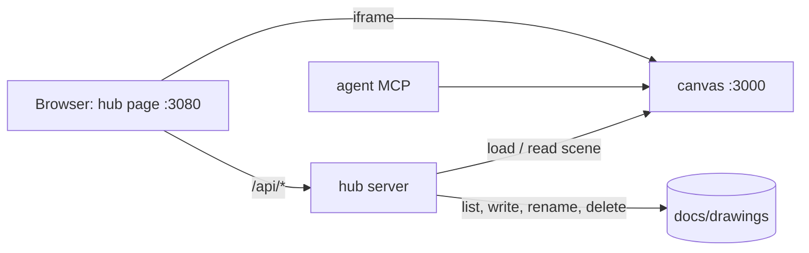

# Excalidraw hub

A local web page that wraps the shared Excalidraw planning canvas with a sidebar of your drawings. You can list, load, save, rename and delete drawings, and a badge shows when the canvas has unsaved changes.

The drawings are the `.excalidraw` files in parent repo's `docs/drawings/`, one folder per project. The canvas is the one parent repo already runs on port 3000, so the agent's Excalidraw MCP sees the same drawing you do.



## Run
Start parent repo's canvas first (`docker compose up -d` at the parent repo root). Then, in this folder:

```bash
cp .env.example .env          # once: saved files get your UID/GID
docker compose up -d --build
```

Open http://localhost:3080. Stop it with `docker compose down`. Details and overrides (port, drawings folder, canvas URL) are in [docs/setup.md](docs/setup.md).

## Use
- **Load:** click a drawing in the sidebar. It replaces what is on the shared canvas, and asks first if the canvas has unsaved changes. If you go ahead, the hub first copies the canvas to `autosave/` (newest 50 kept) and names the file.
- **Save:** pick a project, optionally type a label, click "Save". With no label this overwrites the loaded drawing, unless the canvas came back empty, lost an image, or the file changed on disk. With a label, or with nothing loaded, it writes `<project>[_<label>].excalidraw` and refuses if that file exists. A new project name creates the folder. Every save also writes `<name>.png` next to the drawing.
- **Versioned checkbox:** off by default. Tick it and the button becomes "Save new version", which writes `<project>_v<next>[_<label>].excalidraw` and never overwrites.
- **Rename / delete:** hover a drawing and use ✎ or 🗑. The `.png` with the same name moves or goes with it. Delete asks first.
- **Agents:** an agent can save with `POST /api/save` without any browser tab open. Elements it drew in MCP shorthand (labels, arrow `start`/`end`) are expanded into normal Excalidraw elements on save, and the canvas is updated to match. `GET /api/status` shows how many such elements are waiting (`agentElements`).
- **Unsaved badge:** "● Unsaved changes" after a real edit, "Saved" after a load or save. Leaving the page with unsaved changes shows the browser's warning.

The sidebar marks the highest version of each project as "latest". Files that don't follow the naming scheme are listed as "unversioned". The scheme is defined in parent repo's CLAUDE.md, in the Drawings section.

## Test
```bash
docker run --rm -v "$PWD:/app:ro" -w /app node:20-slim node --test test/   # unit + API
scripts/e2e.sh                                                            # browser tests, Playwright in Docker
```
`scripts/e2e.sh` starts its own canvas (port 3100) and hub (port 3180) over a temporary copy of `fixtures/`. It never touches port 3000 or the real drawings.

## Layout
| Path | What it is |
|---|---|
| `src/` | Server: `names.js` (naming rules), `scene.js` (unsaved detection, save format), `agent.js` (expands agent elements), `store.js` (files), `autosave.js` (backups before a forced load), `canvas.js` (canvas client), `server.js` (HTTP API) |
| `autosave/` | Canvas backups taken before a forced load (gitignored) |
| `public/` | The page: one HTML file, a script and a stylesheet, no build step |
| `test/`, `e2e/` | Unit/API tests (`node --test`) and Playwright browser tests |
| `fixtures/` | Test drawings: copies of parent repo's drawings plus an image test |
| `probe/` | Scripts that checked the canvas behaviour the design relies on |
| `docs/` | [Spec](docs/specs/2026-11-02-excalidraw-hub.md), plans with outcome ([build](docs/plans/2026-11-02-excalidraw-hub.md), [error fixes](docs/plans/2026-11-14-hub-errors.md)), [setup](docs/setup.md) |

## Limits
- Background and grid changes made in the canvas are not saved, because the canvas does not expose them. A saved drawing keeps the background it was loaded with.
- A drawing's background colour is not shown on the canvas after loading.
- Labels an agent drew with no tab open get an estimated size until a tab re-measures them.
- The canvas on port 3000 has no protection against other web pages of its own. A page could rewrite the canvas, and a later unversioned save would then overwrite the loaded file. Git keeps committed states.

Why each design choice was made is in the [spec](docs/specs/2026-11-02-excalidraw-hub.md).
