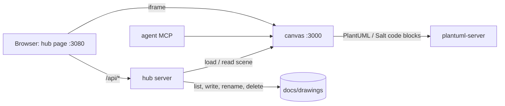
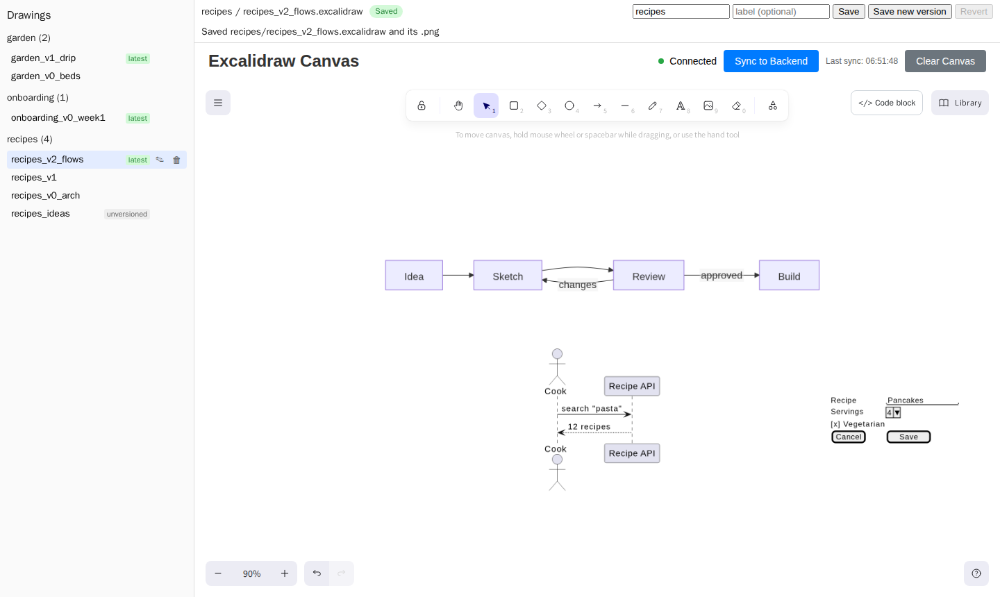

# Excalidraw hub

A local web page that wraps the shared Excalidraw planning canvas with a sidebar of your drawings. You can list, load, save, rename and delete drawings, and a badge shows when the canvas has unsaved changes.

The drawings are the `.excalidraw` files in parent repo's `docs/drawings/`, one folder per project. The canvas is the one parent repo already runs on port 3000, so the agent's Excalidraw MCP sees the same drawing you do.



## What it looks like
Made-up demo data, regenerated with `scripts/screenshots.sh`.


*Sidebar: one folder per project, highest version marked "latest", off-scheme files "unversioned". Hovering a drawing shows rename and delete; ⟳ commits the project to git.*


*Any real edit turns the badge to "● Unsaved changes".*


*Code blocks: paste Mermaid, PlantUML or Salt text and it is rendered on the canvas. Saved here as `recipes_v2_flows` with the form at the top.*


*Hover a code block to switch between diagram and source, or edit it.*

## Run
The canvas runs from this repo too (`canvas/`, a fork of yctimlin/mcp_excalidraw with code blocks), so one compose starts everything. If parent repo's old stock canvas still runs on :3000, stop it first. In this folder:

```bash
cp .env.example .env          # once: saved files get your UID/GID
docker compose up -d --build
```

Open http://localhost:3080. Stop it with `docker compose down`. Details and overrides (port, repo, sync branch, canvas URL) are in [docs/setup.md](docs/setup.md).

The drawings folder must hold at least one entry, such as a project folder. If it is empty, the hub exits and Docker keeps retrying it. That is how it waits out Docker Desktop connecting the folder after a boot.

## Use
- **Load:** click a drawing in the sidebar. It replaces what is on the shared canvas. Unsaved changes are saved first, without asking: into the loaded drawing, or as `tmp/tmp_v<n>` when nothing was loaded. If that save is refused, a popup says why and nothing is loaded.
- **Save:** pick a project, optionally type a label, click "Save". With no label this overwrites the loaded drawing, unless the canvas came back empty, lost an image, or the file changed on disk. With a label, or with nothing loaded, it writes `<project>[_<label>].excalidraw` and refuses if that file exists. A new project name creates the folder. Every save also writes `<name>.png` next to the drawing.
- **Save new version:** writes `<project>_v<next>[_<label>].excalidraw` and never overwrites.
- **Revert:** every overwrite first keeps the old file in `backups/` (newest 20 per drawing). Revert puts the loaded drawing back to its previous saved state; press again to go further back. It asks first, and the file it replaces is kept too.
- **Sync (⟳ on a project):** commits that project's folder in parent repo's git repo as "`<project> <names> diagram update`", only that folder. On `development` (`SYNC_BRANCH`) it also pushes, and only the drawings: other unpushed commits on `development` stay local (then run `git pull --rebase` before pushing it yourself; the message says so). On any other branch it asks, then commits without pushing.
- **Rename / delete:** hover a drawing and use ✎ or 🗑. The `.png` with the same name moves or goes with it. Delete asks first.
- **Agents:** an agent can save with `POST /api/save` without any browser tab open. Elements it drew in MCP shorthand (labels, arrow `start`/`end`) are expanded into normal Excalidraw elements on save, and the canvas is updated to match. `GET /api/status` shows how many such elements are waiting (`agentElements`).
- **Unsaved badge:** "● Unsaved changes" after a real edit, "Saved" after a load or save. Leaving the page with unsaved changes shows the browser's warning.

The sidebar marks the highest version of each project as "latest". Files that don't follow the naming scheme are listed as "unversioned". The scheme is defined in parent repo's CLAUDE.md, in the Drawings section.

## Test
```bash
docker build -t excalidraw-hub-unit . && docker run --rm -u 1000:1000 -e HOME=/tmp -v "$PWD:/app:ro" -w /app excalidraw-hub-unit node --test test/   # unit + API + real git (the image has git)
scripts/e2e.sh   # browser tests, Playwright in Docker, against a throwaway git repo
scripts/screenshots.sh   # regenerates the README images in docs/images/ (same isolated stack, made-up drawings)
```
`scripts/e2e.sh` starts its own canvas (port 3100) and hub (port 3180) over a throwaway git repo holding a copy of `fixtures/`, with a bare repo as its origin. It never touches port 3000, the real drawings or parent repo's git.

## Layout
| Path | What it is |
|---|---|
| `canvas/` | The canvas on :3000: git subtree of a [yctimlin/mcp_excalidraw](https://github.com/yctimlin/mcp_excalidraw) 2.1.2 fork, plus code blocks (paste Mermaid / PlantUML / Salt, hover to toggle code and diagram). Design: `canvas/docs/specs/2026-11-14-code-block.md` |
| `src/` | Server: `names.js` (naming rules), `scene.js` (unsaved detection, save format), `agent.js` (expands agent elements), `store.js` (files), `backups.js` (copies for Revert), `git.js` (sync), `canvas.js` (canvas client), `server.js` (HTTP API) |
| `backups/` | Copies of overwritten drawings, for Revert (gitignored) |
| `public/` | The page: one HTML file, a script and a stylesheet, no build step |
| `test/`, `e2e/` | Unit/API tests (`node --test`) and Playwright browser tests |
| `docs/images/` | README screenshots, made by `scripts/screenshots.sh` from `e2e/readme.shots.js` |
| `fixtures/` | Test drawings: copies of parent repo's drawings plus an image test |
| `probe/` | Scripts that checked the canvas behaviour the design relies on |
| `docs/` | [Spec](docs/specs/2026-11-02-excalidraw-hub.md), plans with outcome ([build](docs/plans/2026-11-02-excalidraw-hub.md), [error fixes](docs/plans/2026-11-14-hub-errors.md), [save/revert/sync](docs/plans/2026-11-14-save-revert-sync.md)), [setup](docs/setup.md) |

## Limits
- Background and grid changes made in the canvas are not saved, because the canvas does not expose them. A saved drawing keeps the background it was loaded with.
- A drawing's background colour is not shown on the canvas after loading.
- Labels an agent drew with no tab open get an estimated size until a tab re-measures them.
- The canvas on port 3000 has no protection against other web pages of its own. A page could rewrite the canvas, and a later unversioned save would then overwrite the loaded file. Git keeps committed states.

Why each design choice was made is in the [spec](docs/specs/2026-11-02-excalidraw-hub.md).
