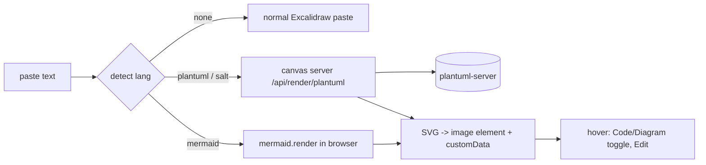

# Spec: code block (Mermaid, PlantUML, Salt)

## Goal
A canvas element that holds diagram source text and shows it rendered. Pasting diagram text creates one. Hovering it offers a toggle between **code view** (the source text) and **diagram view** (the render), plus **Edit**.

Languages: **Mermaid** (v1), **PlantUML** and **Salt** (PlantUML's wireframe syntax, https://plantuml.com/salt) (v2, same renderer).

## Not building
- A true new Excalidraw element type. That means forking `@excalidraw/excalidraw` itself (renderer, restore, export, hit-testing), and stock Excalidraw would drop the unknown type from saved files.
- Live inline text editing on the canvas. Editing happens in a textarea overlay.
- Rotation support for the hover overlay (rotated blocks still render; the buttons sit on the unrotated bounds).
- Agent/MCP tools to create code blocks. An agent can still write the element via REST (see Data model), but nothing renders it until a browser tab does.
- Hub changes. The hub stores `customData` and the image file as is (verified: `buildDocument` spreads elements, keeps files used by image elements).

## Decisions
| Decision | Based on |
|---|---|
| A code block is a stock `image` element with `customData`. The image is the current view rendered to SVG, then rasterised to PNG (2×) in the browser. | Saves stay valid `.excalidraw`; stock Excalidraw shows the last render. Exports and the hub's PNG-on-save just work. |
| Not an `embeddable` with `renderEmbeddable` | 0.18.1 `exportToCanvas/Svg` render embeddables only "when possible" (live iframes), and the hub writes a PNG on every save, so it would come out blank. |
| Both views go through the same SVG → PNG path. Code view = monospace SVG of the source, generated in the browser. | One element, one mechanism; code view also exports. |
| PNG, not SVG, in `files` (decided after probe, 2026-11-14) | The canvas server's headless exporter (resvg) draws an SVG image's shapes but drops its text, even with the font loaded (`probe/svg-image.sh`). PNG renders everywhere. |
| Renderers sit behind `render(lang, source) → Promise<svg string>` in `frontend/src/codeblock/render.ts` | Adding a language means adding one renderer entry. |
| Mermaid renders in the browser with the bundled `mermaid` package (`mermaid.render`). | Already a dependency (^11.17). No server needed. |
| PlantUML and Salt render via a local `plantuml/plantuml-server` container. The canvas server proxies `POST /api/render/plantuml` to `PLANTUML_URL`. | Heavy Java stack stays in Docker. Same-origin proxy avoids CORS and keeps the renderer off host ports. Never the public plantuml.com server: diagram text would leave the machine. |
| Creation: (1) paste of text detected as a known language, via Excalidraw's `onPaste` prop; (2) a "Code block" button that opens the editor empty. | User asked for paste; the button covers typing from scratch. |
| Hover UI: an absolutely positioned overlay in `App.tsx`, shown when the pointer (`onPointerUpdate`) is inside a code block's bounds, positioned with `sceneCoordsToViewportCoords`. Buttons: `Code` / `Diagram` toggle, `Edit`. | No Excalidraw API for per-element hover UI; this is the documented coordinate helper. |
| On render error the diagram view shows the error text (as SVG) and keeps the source. | Never lose the user's text. |

## Data model
```jsonc
{
  "type": "image", "fileId": "codeblock-<hash of current png>", "status": "saved",
  "customData": {
    "kind": "codeblock",
    "lang": "mermaid" | "plantuml" | "salt",
    "source": "graph TD; A-->B",
    "view": "diagram" | "code"
  }
}
```
Toggle or edit: render the new view → add the file (`addFiles`, and `POST /api/files` via the existing sync) → update `fileId`, keep `x`, `y`, keep width, scale height to the new aspect ratio. Old files stay on the canvas server until reload; the hub drops unused files on save.

## Language detection (paste)
First match wins:
1. Fenced block ```` ```mermaid ````, ```` ```plantuml ````, ```` ```puml ````, ```` ```salt ```` → that language, fence stripped.
2. `@startsalt`, or `@startuml` followed by a `salt` line → `salt`.
3. `@startuml` / `@start<anything>` → `plantuml`.
4. First non-empty line starts with a Mermaid diagram keyword (`graph`, `flowchart`, `sequenceDiagram`, `classDiagram`, `stateDiagram`, `erDiagram`, `gantt`, `pie`, `mindmap`, `timeline`, `journey`, `gitGraph`, …) → `mermaid`.
5. Otherwise: not a code block, paste proceeds as normal.



## Resolved questions
- Headless renderer and SVG images: text is dropped, so PNG (see Decisions).
- Mermaid `<foreignObject>` labels would taint the rasterising canvas: rendered with `htmlLabels: false`.
- Paste detection: Mermaid keywords are English words ("pie", "timeline"), so the rest of the first line must be Mermaid syntax too.
