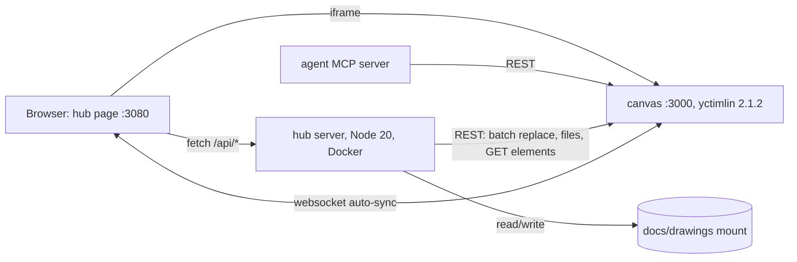

# Excalidraw hub

Date: 2026-11-02 · Status: approved by mandate (handoff `/tmp/handoff-excalidraw-hub.md`, one-shot build)

## Goal
A local web page that wraps the shared Excalidraw planning canvas (`http://127.0.0.1:3000`, parent repo `compose.yaml`) with a sidebar of projects (folders in parent repo `docs/drawings/`) and their versioned drawings. The user can **list, load, save, rename, delete** drawings and sees an **unsaved-changes** indicator. Runs with `docker compose up`.

## Architecture

## Decisions
Each decision states what it is based on.

### Drive the existing canvas, embed it in an iframe
- The hub does not ship its own Excalidraw. It loads drawings into the shared canvas over the canvas REST API and reads them back from it. Based on: the agent's MCP server only sees the `:3000` canvas, so a separate Excalidraw would cut the agent out of planning (handoff). The canvas sends no frame-blocking headers (`curl -I`, 2026-11-02), so an iframe works.
- **Fallback, not built:** a standalone app on `@excalidraw/excalidraw`. Only needed if round-trip fidelity fails (see below).

### Load and save use the raw canvas API, not the MCP's scene export
- **Load:** upload each image file to `POST /api/files` (one per request: the canvas JSON limit is 10 MB), then `POST /api/elements/batch {replace: true}` with the file's non-deleted elements as they are.
- **Save:** `GET /api/elements` and `GET /api/files`, strip the keys the canvas server adds (`createdAt`, `updatedAt`, `syncedAt`, `source`, `syncTimestamp`), keep only files referenced by live image elements, write the file.
- Based on: probes `probe/roundtrip.mjs` and `probe/binding-diff.mjs`. The raw path is lossless on all fixtures except for key order inside objects. The MCP's `buildSceneFile` re-expands elements. It is lossless for MCP-made files but rewrote a browser-exported file (`budgeting_v0_plan`): 37 sharp rectangles became rounded (`roundness null → {type:3}`) and every `index` was renumbered.
- The canvas file map is never cleared by `clear` or batch replace, so filtering by reference stops a save from inheriting images from earlier loads.

### appState is carried by the hub, not the canvas
- The canvas stores no appState. The hub remembers the loaded file's `appState` and writes it back on save (default `{viewBackgroundColor: "#ffffff", gridSize: null}`, as the MCP export writes).
- **Known limits:** background or grid changes made in the canvas are not saved, and a loaded background colour is not shown. Based on: canvas source (`dist/server.js`, no appState route).

### Save: two buttons, "Save" and "Save new version"
Changed 2026-11-05 (opt-in checkbox) and 2026-11-14 (two buttons, at the user's request; the checkbox is gone). The API keeps the `versioned` flag: "Save" sends `false`, "Save new version" sends `true`.
- **"Save new version" (`versioned: true`):** writes `<project>_v<n>[_<label>].excalidraw`, where `n` is the highest `v<i>` in the folder plus one, or `0` when no file follows the scheme. It never overwrites.
- **"Save" (`versioned: false`):**
  - No label and a drawing from this project is loaded: overwrites that drawing, like Save in an editor.
  - Otherwise: writes `<project>[_<label>].excalidraw`, and refuses (409) if that file exists. A label never overwrites, not even the loaded drawing. A label with no `a-z`/`0-9` is refused (400) rather than treated as no label.
- Only the loaded drawing can be overwritten, so a mistyped label or project name cannot destroy another file. Overwrites replace the file atomically (synced temp file, then rename). Based on: an overwrite is the one way a save can lose data.
- **An overwrite is refused (409) when something looks wrong.** "Save new version" still saves in these cases. Based on: independent review, 2026-11-05.
  - The canvas is empty but the drawing was not. The canvas is in-memory, so a restart would otherwise wipe the file.
  - A live image element's file is missing from the canvas.
  - The file changed on disk since load or save (mtime + size), e.g. `git pull` or an agent's export.
- A load forgets the baseline before touching the canvas. If it fails or times out, the canvas may hold anything, so the next save must not treat it as the old drawing.
- **No confirm on overwrite.** Save on a loaded file is what the button says. Every overwrite first copies the old file to the backups folder, so Revert can bring it back (see "Revert").
- **Known limits:** overwriting resets the file's mode to the default. A second tab showing an older drawing can overwrite the drawing loaded from the first tab until its 2 s poll catches up (accepted: narrow window, and the status poll shows the current file).
- The API requires the `versioned` flag and answers 400 without it. Based on: a tab opened before the flag existed sends none; defaulting to off would make its click overwrite.
- Saving into a new project name creates the folder.

### Listing and naming
- A project is a direct subfolder of the drawings root. A drawing is a `.excalidraw` file in it. Files matching `^<project>_v(\d+)(?:_(.+))?\.excalidraw$` get a version and label. **Latest** is the highest version. Other files (`board-*`, `party-photo`, `board-with-f1`) are listed plainly after versioned ones. Based on: CLAUDE.md Drawings section and the legacy folders it names.
- A `.png` with the same base name is a companion: rename moves it, delete removes it. Based on: "a PNG of a version uses the same base name".
- Rename keeps the drawing in its project and takes a full new base name.

### Unsaved-changes indicator
- The hub server keeps a baseline from the last load or save. `GET /api/status` compares the canvas elements with it and reports `dirty`.
- **Hybrid compare.** Based on probes `probe/dirty-canon.mjs` and `probe/dirty-hybrid.mjs` (all 8 fixtures).
  - The open tab does not re-sync after a REST load. It re-syncs the whole scene on its next `onChange` (any tool click), debounced 1.2 s. That sync normalizes elements: `null` becomes `[]` or `false`, text widths are re-measured, unknown keys (`fontSize` on rectangles) are dropped, and stale `boundElements` back-references are repaired.
  - **Strict form:** non-deleted elements sorted by `id`, volatile keys removed (`version`, `versionNonce`, `updated` and the server-added keys), empty values (`null`, `false`, `[]`) dropped, numbers rounded to 2 decimals, `boundElements` sorted by id.
  - **Tolerant form:** strict, minus `boundElements` (derived back-pointers; the forward pointers are still compared), minus text `width`/`height`, minus bound-text `x`/`y`. A key present only in the baseline is ignored.
  - Until anchored, `dirty` = tolerant mismatch. The first time the canvas is fully browser-synced (every element has `source: "frontend_sync"`) and tolerantly equal, the strict form of that state becomes the anchor. After that, `dirty` = strict mismatch.
  - Result: clean after load, clean after harmless interactions, dirty after drawing a rectangle, on every fixture.
  - **Known blind spot before the first sync:** clearing a value to empty (e.g. removing a link) or resizing a text box is not seen until the anchor is set. Accepted.
- The page polls status every 2 s, shows "unsaved changes", asks before loading over unsaved work (load wipes the shared canvas), and sets a `beforeunload` warning.
- A canvas with elements but no load/save in this hub session counts as unsaved.

### Agent-format elements are expanded on save
Changed 2026-11-14 (plan `docs/plans/2026-11-14-hub-errors.md`). The first version refused to save while shorthand was present and waited for a browser tab to convert it. With no tab open that wait never ended, so agents could not save on their own (E1).
- **Agent format:** what the canvas stores for elements no tab has seen yet. Either MCP shorthand (`label: {text}` on shapes and arrows, `start`/`end: {id}` on arrows), or a skeletal element with no `seed` (no defaults filled in).
- **Save expands them on the server** (`src/agent.js`), the way an open tab would. Based on the tab probe `probe/2026-11-14-tab-conversion.mjs`:
  - `label` becomes a bound text element `<id>-label` (fontSize 20, fontFamily 5, centred on the shape or the arrow's middle point), size estimated at 0.5 × fontSize per character and 1.25 × fontSize per line. A container that already has a bound text gets its text replaced instead.
  - `start`/`end` become `startBinding`/`endBinding` (`focus: 0`, `gap: 8`) plus `boundElements` back-references. A binding to a missing element is dropped.
  - Missing defaults are filled in, never overwritten (`roundness: null`, random `seed`, 100 × 100 for a shape with no size, …). `text` on a shape is dropped, as the tab drops it. `start: null` leaves an existing binding alone.
  - Array order (z-order) is kept and new label texts go last. Agent elements and labels without an `index` get keys after the current highest one. Nothing is renumbered, and complete elements without an index are left to the tab.
  - Complete elements are untouched, except a shape gaining an arrow back-reference or a bound text getting new label text. Those get `version + 1`, a new `versionNonce` and `updated`, so a connected tab does not keep its older copy.
- **Not the canvas's own `expandElementsForExport`.** It rewrites every element: `null` roundness becomes rounded and every `index` is renumbered (see "Load and save use the raw canvas API").
- **The file is written first, then the expanded scene goes back to the canvas** (`batch replace`), and the baseline is taken from the re-read canvas. Otherwise status reports unsaved right after the save, and a tab opened later would convert the shorthand again with its own measurements.
  - A refused save (existing name, overwrite guards) therefore leaves the canvas untouched.
  - The write-back happens only if the canvas is unchanged since the save read it (ids, `updatedAt`, `version`). A replace wipes everything not in it, so an element an agent added in between would be lost. If the canvas moved on, it stays as it is and status shows it as unsaved. The response says `writtenBack: true|false`. Based on: independent review, 2026-11-14.
  - **Residual risk:** a write landing between that re-check and the replace (two back-to-back requests) is still lost. Accepted: the canvas has no compare-and-swap.
- **Expansion runs even with a tab connected.** A tab converts on its next change only, and a hidden tab may be throttled, so waiting for it can block again. A race with a converting tab is benign: both name labels `<id>-label`, so the worst case is a later "unsaved" flag, not duplicates.
- `/api/status` reports `agentElements`, the count of agent-format elements on the canvas.
- **Known limit:** estimated label sizes are approximate until a tab re-measures the text.

### Switching drawings saves first, no question
Changed 2026-11-14 at the user's request. It replaces "Forced load backs up the canvas first" (confirm dialog + autosave folder).
- Loading a drawing while the canvas has unsaved changes saves them first, in the same request, then loads:
  - **A drawing is loaded:** overwrite it, exactly like "Save" (same guards, and the old file is copied to the backups folder first).
  - **Nothing is loaded** (drawn from scratch or by an agent): save as the next version in the `tmp` project (`docs/drawings/tmp/tmp_v<n>.excalidraw`), creating the folder.
  - **The save is refused** (overwrite guards): nothing is loaded and the page shows the reason in a popup. The message suggests "Save new version", which still saves in those cases.
  - **The canvas is empty** (e.g. it restarted): nothing to save, the load goes ahead.
- The load response names what was saved (`autosaved: {project, file}`); the page shows it. The `force` flag is gone; a caller that still sends it gets the save-first behaviour, which loses nothing.
- Based on: the user wants no prompt on switching, and unsaved work must not be lost (E3).

### Revert
Added 2026-11-14 at the user's request.
- Every overwrite (Save, or save-before-switch) first copies the file being replaced to `BACKUPS_DIR/<project>/<base>/<timestamp>.excalidraw`, newest 20 per drawing. Backups live outside `docs/drawings`, which is git-tracked; compose mounts `./backups` (gitignored).
- **Revert** (button next to the save buttons) restores the loaded drawing's newest backup over the file, removes that backup and loads it onto the canvas; a second Revert goes one step further back. The file it replaces is kept in `_reverted`, which Revert never reads. The page asks first. The PNG is re-rendered.
  - Only the loaded drawing can be reverted (409 otherwise).
  - **Unsaved canvas edits** are saved over the file first, then the revert restores the backup that save made. Net effect: the drawing goes back to its last saved state, and the edits are kept in `_reverted`. If that save is refused, nothing is reverted. Based on: independent review, 2026-11-14 (the first version dropped the edits with no copy).
- The listing reports `backups` per drawing; Revert is disabled when the loaded drawing has none. Rename moves a drawing's backups with it. Delete keeps them (not shown anywhere; safety copy).
- Not built: browsing or choosing among older backups.

### PNG on save
Added 2026-11-14 (E4).
- After every save the hub asks the canvas to render the scene (`POST /api/export/image`, headless node renderer, no tab needed) and writes `<base>.png` next to the drawing atomically. An overwrite regenerates it, so the PNG is no longer stale.
- Best-effort: if rendering fails, the save still succeeds and reports `pngError`.

### Sync a project to git
Added 2026-11-14 at the user's request.
- Each project row has a sync button (right side, like rename and delete). It commits that project's folder in parent repo's repo:
  1. Nothing changed under `docs/drawings/<project>`: say so, do nothing.
  2. Check the repo. A detached HEAD or a merge, rebase, cherry-pick or revert in progress is refused with a message; nothing is touched.
  3. Check the branch. On `SYNC_BRANCH` (default `dev`): commit and push. On any other branch: the page asks "commit anyway?"; yes commits **without pushing**. Based on the user: push only from dev.
  4. On `SYNC_BRANCH`, only the drawings are ever published, with no question. Changed 2026-11-14 at the user's request (a "push them too?" confirm was rejected).
  5. `git add -A -- <folder>`, then `git commit -m "<project> <names> diagram update" -- <folder>`. The pathspec commits only that folder, so other staged or changed files in the repo stay out. `<names>` are the changed drawings without the `<project>_` prefix (`chartroom v2 diagram update`), comma-separated, at most 5 then `+N more`.
  6. Push, after `git fetch origin <SYNC_BRANCH>`:
     - Local branch exactly one commit (this one) ahead of origin: plain `git push`.
     - Plain push is pinned to the commit (`<sha>:refs/heads/<SYNC_BRANCH>`), so a commit landing meanwhile is not pushed with it.
     - Otherwise (other local unpushed commits, or origin moved on): the commit is **cherry-picked** onto `origin/<SYNC_BRANCH>` in a throwaway detached worktree (`git worktree add`, removed afterwards) and pushed as `HEAD:refs/heads/<SYNC_BRANCH>`. Only this commit's change goes up, so changes made on origin meanwhile are kept, even in the same folder. Where both sides changed the same file, this commit's version of that file wins. Other local commits stay local.
     - Local and origin then each hold a copy. `git pull --rebase` drops the local copy because the patches match (tested, also for repeated syncs). It can still conflict if an earlier local-only commit touched the same drawing; then it is resolved by hand. The page says to run it before pushing the branch by hand.
     - No `git worktree prune`: inside the container the user's own worktrees look missing and would be unregistered (independent review).
     - Based on: simpler than branching out and squash-merging back, and it never touches the user's checkout or working tree. Replacing the whole folder instead (first version) silently reverted changes made on origin (independent review).
     - If the push fails, the local commit stays and the page shows git's error. Pushes run one at a time.
- **How:** the hub image adds `git` and `openssh-client`. Compose mounts parent repo's root read-write at `/repo` (drawings are `/repo/docs/drawings`), and the host's `~/.ssh` and `~/.gitconfig` read-only, so commits carry the user's identity and push with the user's key (no passphrase). Commands run through `execFile` with fixed arguments; the project name is validated like every other name.
- With no `REPO_DIR` the feature is off: `/api/config` says `sync: false` and the button is hidden. The hub still works when cloned alone.
- **Accepted risk:** the container can write anywhere in the parent repo repo and push with the user's key. Requests are limited as before (loopback port, Host allowlist, same-origin JSON only).
- Not built: pull, conflict handling, choosing a branch.

### Server: Node 20 built-ins, no framework
- About six JSON routes plus static files. `node:http` and `node:test` cover this with zero dependencies, no lockfile and no install step. Based on: SMORES Simple; "build your own only when clearly cheaper": a router this size is ~40 lines, cheaper than adding and pinning express.
- Modules, each testable alone: `names.js` (pure naming/versioning), `store.js` (filesystem under a root), `canvas.js` (canvas REST client), `scene.js` (canonical hash, save body), `server.js` (HTTP wiring). UI is one static page, no build step.

### Safety
- Names (project, file base) must match `^[A-Za-z0-9][A-Za-z0-9._-]{0,120}$` and contain no `..`. Resolved paths must stay under the root, and symlinks are rejected (`lstat`).
- The port is published on host `127.0.0.1` only (the server binds `0.0.0.0` inside the container). A `Host` allowlist (`HUB_ALLOWED_HOSTS`, default `127.0.0.1:<port>,localhost:<port>`) blocks DNS rebinding. State-changing requests require `Content-Type: application/json` and, when an `Origin` header is present, the hub's own origin. Based on: a web page could otherwise POST to localhost and delete drawings (CSRF).
- The page sends `X-Frame-Options: DENY` and a CSP (`frame-ancestors 'none'`, `frame-src` = the canvas origin only), against clickjacking.
- Load, save, rename and delete run one at a time (a promise queue), because they share the baseline and the canvas.
- Rename and save move files all-or-nothing: every destination is hard-linked first (fails if it exists), then the sources are unlinked. A `.png` already at the rename destination is a conflict, even when the source has none.
- **Accepted risk:** the canvas on `:3000` has no CSRF or Host guard of its own (upstream). A web page could rewrite the shared canvas. The hub cannot fix this. With versioning off, a save after such a rewrite would overwrite the loaded file; git keeps committed states.
- Container runs as the host user (`UID`/`GID` from `.env`, default 1000) so files in the repo aren't root-owned.

### Docker and networking
- `compose.yaml`: one `hub` service on the default bridge network, published on `127.0.0.1:3080`. Since 2026-11-14 it mounts the parent repo root (`/repo`), `./backups`, `~/.ssh` and `~/.gitconfig` (see "Sync a project to git"). It reaches the canvas at `http://host.docker.internal:3000` (`extra_hosts: host-gateway`). The iframe uses `http://localhost:3000`. Drawings are mounted from `${HUB_DRAWINGS:-../../docs/drawings}`. It expects the parent repo canvas to be running.
- **Not host networking.** This Docker is Docker Desktop (`docker info`): `network_mode: host` binds inside its VM, so WSL and Windows could not reach the hub (observed 2026-11-02). Published ports are forwarded to WSL, as the canvas on `:3000` shows.
- **Boot race (added 2026-11-14).** When Docker Desktop starts, `restart: unless-stopped` starts the hub a few seconds before Docker Desktop's WSL proxy connects the WSL bind mounts. The hub then gets an empty mount (then `/data`, now `/repo`, so `DRAWINGS_DIR` = `/repo/docs/drawings` is missing) and keeps it until it restarts. Docker Desktop's backend log for 2026-11-11 shows the hub starting at 08:17:56Z and the drawings mount connecting at 08:18:03Z. Decision: before listening, the hub checks `DRAWINGS_DIR`, and if it is missing or empty it logs one line and exits with code 1. Docker's restart policy retries it with backoff, and once the folder is connected the hub starts normally. Based on: a plain `docker restart` with the proxy up restored the mount (tested 2026-11-11); waiting inside the process cannot help, because a container's mounts are fixed when it starts. Only `DRAWINGS_DIR` is checked: the proxy connects all of a container's mounts in one pass, milliseconds apart, and `docs/drawings` is never legitimately empty in parent repo. With the repo mounted at `/repo`, the same check covers it (an unconnected repo means `docs/drawings` is missing). Assumed, not verified: `~/.ssh`, `~/.gitconfig` and `/backups` are connected in the same proxy pass as `/repo`, so they are not checked separately. If that is wrong, a late `~/.gitconfig` shows up as an empty directory and every git call fails ("Is a directory") until the next restart; drawings still work. A startup check on them is not built, because compose always mounts them, so a host without `~/.gitconfig` would crash-loop forever. Verify on a real boot: sync works without a restart. Not built: a Windows logon task or WSL startup script that recreates the container.
- `compose.test.yaml`: its own canvas, a hub over a fixture copy and a Playwright runner (image and npm package both `1.56.1`), talking over the compose network by service name. Tests never touch port 3000 or the real drawings.

## Out of scope
- A new-project button separate from save, moving drawings between projects.
- Syncing appState from the canvas, multi-user locking, auth.
- Cleaning stale image files out of the canvas memory.
- Element types the canvas rejects (`embeddable`, `iframe`, `magicframe`): load reports the canvas error.

## Findings
- REST load→save is lossless on all fixtures, including an image element with its file and a freedraw element (`fixtures/image-test`). `party-photo` contains no image, despite its name.
- The MCP export (`buildSceneFile`) is not safe for browser-made files: it rounded 37 rectangles and renumbered `index`.
- The canvas accepts `rectangle, ellipse, diamond, arrow, text, freedraw, line, image, frame` only (`dist/types.js`).
- Probes ran against an isolated canvas container on `127.0.0.1:3100`, with Playwright `1.56.1` in Docker.
