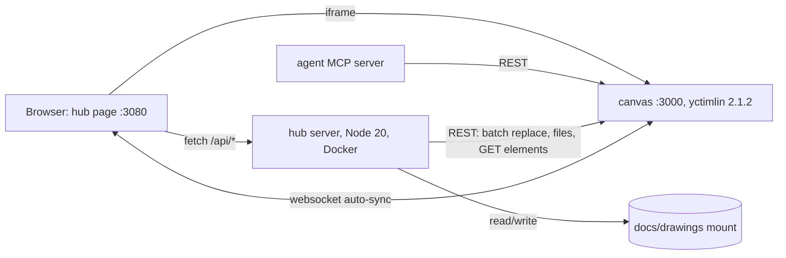

# Excalidraw hub

Date: 2026-11-02 · Status: approved by mandate (handoff `/tmp/handoff-excalidraw-hub.md`, one-shot build)

## Goal
A local web page that wraps the shared Excalidraw planning canvas (`http://127.0.0.1:3000`, parent repo `compose.yaml`) with a sidebar of projects (folders in parent repo `docs/drawings/`) and their versioned drawings. The user can **list, load, save, rename, delete** drawings and sees an **unsaved-changes** indicator. Runs with `docker compose up`.

## Architecture

## Decisions
Each decision states what it is based on.

### Drive the existing canvas, embed it in an iframe
- The hub does not ship its own Excalidraw. It loads drawings into the shared canvas over the canvas REST API and reads them back from it. Based on: the agent's MCP server only sees the `:3000` canvas, so a separate Excalidraw would cut the agent out of planning (handoff). The canvas sends no frame-blocking headers (`curl -I`, 2026-11-02), so an iframe works.
- **Fallback, not built:** a standalone app on `@excalidraw/excalidraw`. Only needed if round-trip fidelity fails (see below).

### Load and save use the raw canvas API, not the MCP's scene export
- **Load:** upload each image file to `POST /api/files` (one per request: the canvas JSON limit is 10 MB), then `POST /api/elements/batch {replace: true}` with the file's non-deleted elements as they are.
- **Save:** `GET /api/elements` and `GET /api/files`, strip the keys the canvas server adds (`createdAt`, `updatedAt`, `syncedAt`, `source`, `syncTimestamp`), keep only files referenced by live image elements, write the file.
- Based on: probes `probe/roundtrip.mjs` and `probe/binding-diff.mjs`. The raw path is lossless on all fixtures except for key order inside objects. The MCP's `buildSceneFile` re-expands elements. It is lossless for MCP-made files but rewrote a browser-exported file (`budgeting_v0_plan`): 37 sharp rectangles became rounded (`roundness null → {type:3}`) and every `index` was renumbered.
- The canvas file map is never cleared by `clear` or batch replace, so filtering by reference stops a save from inheriting images from earlier loads.

### appState is carried by the hub, not the canvas
- The canvas stores no appState. The hub remembers the loaded file's `appState` and writes it back on save (default `{viewBackgroundColor: "#ffffff", gridSize: null}`, as the MCP export writes).
- **Known limits:** background or grid changes made in the canvas are not saved, and a loaded background colour is not shown. Based on: canvas source (`dist/server.js`, no appState route).

### Save always writes a new version
- Save writes `<project>_v<n>[_<label>].excalidraw`, where `n` is the highest `v<i>` in the folder plus one, or `0` when no file follows the scheme. The file is created exclusively (`wx`) after writing a temp file, so a save never overwrites.
- **Not building "overwrite".** Based on: parent repo's Drawings rule ("each meaningful new state gets the next `v<i>`"); git already keeps history; rename covers fixing a label. One code path is simpler to test.
- Saving into a new project name creates the folder.

### Listing and naming
- A project is a direct subfolder of the drawings root. A drawing is a `.excalidraw` file in it. Files matching `^<project>_v(\d+)(?:_(.+))?\.excalidraw$` get a version and label. **Latest** is the highest version. Other files (`board-*`, `party-photo`, `board-with-f1`) are listed plainly after versioned ones. Based on: CLAUDE.md Drawings section and the legacy folders it names.
- A `.png` with the same base name is a companion: rename moves it, delete removes it. Based on: "a PNG of a version uses the same base name".
- Rename keeps the drawing in its project and takes a full new base name.

### Unsaved-changes indicator
- The hub server keeps a baseline from the last load or save. `GET /api/status` compares the canvas elements with it and reports `dirty`.
- **Hybrid compare.** Based on probes `probe/dirty-canon.mjs` and `probe/dirty-hybrid.mjs` (all 8 fixtures).
  - The open tab does not re-sync after a REST load. It re-syncs the whole scene on its next `onChange` (any tool click), debounced 1.2 s. That sync normalizes elements: `null` becomes `[]` or `false`, text widths are re-measured, unknown keys (`fontSize` on rectangles) are dropped, and stale `boundElements` back-references are repaired.
  - **Strict form:** non-deleted elements sorted by `id`, volatile keys removed (`version`, `versionNonce`, `updated` and the server-added keys), empty values (`null`, `false`, `[]`) dropped, numbers rounded to 2 decimals, `boundElements` sorted by id.
  - **Tolerant form:** strict, minus `boundElements` (derived back-pointers; the forward pointers are still compared), minus text `width`/`height`, minus bound-text `x`/`y`. A key present only in the baseline is ignored.
  - Until anchored, `dirty` = tolerant mismatch. The first time the canvas is fully browser-synced (every element has `source: "frontend_sync"`) and tolerantly equal, the strict form of that state becomes the anchor. After that, `dirty` = strict mismatch.
  - Result: clean after load, clean after harmless interactions, dirty after drawing a rectangle, on every fixture.
  - **Known blind spot before the first sync:** clearing a value to empty (e.g. removing a link) or resizing a text box is not seen until the anchor is set. Accepted.
- The page polls status every 2 s, shows "unsaved changes", asks before loading over unsaved work (load wipes the shared canvas), and sets a `beforeunload` warning.
- A canvas with elements but no load/save in this hub session counts as unsaved.

### Agent-shorthand guard
- Elements the agent creates with no tab open are stored in shorthand (`label`, `start`, `end`). Save refuses with a 409 if any are present, asking to retry once the canvas tab has synced. With the hub page open, the iframe converts them within about 1.2 s. Based on: canvas `CreateElementSchema` and frontend sync code.

### Server: Node 20 built-ins, no framework
- About six JSON routes plus static files. `node:http` and `node:test` cover this with zero dependencies, no lockfile and no install step. Based on: SMORES Simple; "build your own only when clearly cheaper": a router this size is ~40 lines, cheaper than adding and pinning express.
- Modules, each testable alone: `names.js` (pure naming/versioning), `store.js` (filesystem under a root), `canvas.js` (canvas REST client), `scene.js` (canonical hash, save body), `server.js` (HTTP wiring). UI is one static page, no build step.

### Safety
- Names (project, file base) must match `^[A-Za-z0-9][A-Za-z0-9._-]{0,120}$` and contain no `..`. Resolved paths must stay under the root, and symlinks are rejected (`lstat`).
- Server binds `127.0.0.1`. State-changing requests require `Content-Type: application/json` and, when an `Origin` header is present, the hub's own origin. Based on: a web page could otherwise POST to localhost and delete drawings (CSRF).
- Container runs as the host user (`UID`/`GID` from `.env`, default 1000) so files in the repo aren't root-owned.

### Docker and networking
- `compose.yaml`: one `hub` service, `network_mode: host` (as `.claude/mcp/excalidraw.sh` does), drawings mounted from `${DRAWINGS_DIR:-../../docs/drawings}`. Env: `CANVAS_URL` (server → canvas), `CANVAS_PUBLIC_URL` (iframe src), `HUB_PORT` (3080). It expects the parent repo canvas to be running.
- `compose.test.yaml`: an isolated canvas on 3100, a hub on 3180 with a fixture copy, and a Playwright runner (image and npm package both `1.56.1`). Tests never touch port 3000 or the real drawings.

## Out of scope
- Overwrite-save, a new-project button separate from save, moving drawings between projects.
- Syncing appState from the canvas, multi-user locking, auth.
- Cleaning stale image files out of the canvas memory.
- Element types the canvas rejects (`embeddable`, `iframe`, `magicframe`): load reports the canvas error.

## Findings
- REST load→save is lossless on all fixtures, including an image element with its file and a freedraw element (`fixtures/image-test`). `party-photo` contains no image, despite its name.
- The MCP export (`buildSceneFile`) is not safe for browser-made files: it rounded 37 rectangles and renumbered `index`.
- The canvas accepts `rectangle, ellipse, diamond, arrow, text, freedraw, line, image, frame` only (`dist/types.js`).
- Probes ran against an isolated canvas container on `127.0.0.1:3100`, with Playwright `1.56.1` in Docker.
