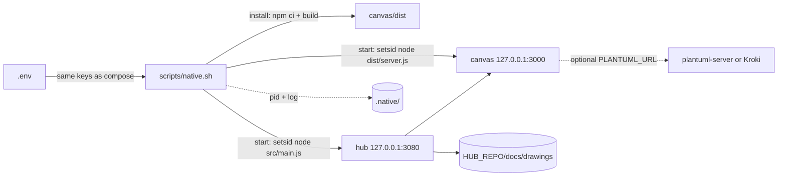

# Spec: run without Docker

## Goal
Install and run the hub and its canvas with only Node.js and git on the host. Docker (`compose.yaml`) stays a supported option, unchanged. Both runtimes are used one at a time, never together: they share :3000 and :3080.

## Not building
- No native PlantUML renderer. PlantUML/Salt code blocks need `PLANTUML_URL` pointing at a renderer the user runs or trusts (plantuml-server, Kroki; see `docs/setup.md` Diagram renderers). Mermaid code blocks render in the browser and work without one.
- No autostart at boot and no restart on crash. Under Docker, `restart: unless-stopped` covers that. Natively, the user runs `scripts/native.sh start`. A systemd user unit is the next step if that is ever wanted.
- No Windows-native or macOS support. The target is WSL/Linux bash: the script uses `setsid` and `/dev/tcp`.
- No change to the hub code paths, the canvas or the compose files for this feature. (The same merge also brought the external-renderer switch, which does change them: `docs/plans/2026-11-16-external-renderer.md`.)
- No `${VAR}` interpolation or backslash escapes in `.env`: `native.sh` refuses such a value instead of reading it differently from compose.

## Design

`scripts/native.sh install | start | stop | restart | status`
- `install`: checks Node ≥ 20 and git, then runs `npm ci && npm run build` in `canvas/` (the same steps as `canvas/Dockerfile.canvas`). The hub has no npm dependencies.
- `start`: refuses if :3000 or :3080 is held by something else (for example the Docker stack). Starts the canvas, waits for `/health`, starts the hub, waits for `/api/status`. Both bind to 127.0.0.1 only. If either fails, it prints the last log lines and stops what this call started.
- Pid files only count while the pid is still our `node dist/server.js` / `node src/main.js` (checked in `/proc`), because pids get reused after a reboot. `stop` kills the process group: SIGTERM, then SIGKILL after 5 s.
- Config: the same variables as `.env.example` (`HUB_PORT`, `HUB_REPO`, `HUB_BACKUPS`, `SYNC_BRANCH`, `CANVAS_URL`, `CANVAS_PUBLIC_URL`), plus `CANVAS_PORT`, `DRAWINGS_DIR`, `PLANTUML_URL`, `HUB_ALLOWED_HOSTS`. Shell variables win over `.env`, as with compose.
- Git sync uses the host's own git, identity and SSH agent. The no-passphrase limit of the container goes away.

## Decisions
| Decision | Based on |
|---|---|
| One ~100-line bash script, not pm2 or another process manager | Two processes with start/stop/status. A manager adds a global install and its own concepts for no gain at N=2. Integrate-don't-reinvent: the build reuses the canvas's own npm scripts. |
| Background processes with pid files in `.native/`, rather than a foreground run | Matches the Docker usage (`up -d`, open the browser). `setsid` puts each process in its own group, so `stop` also kills child processes. |
| Reuse `.env`, parsed by compose's rules (quotes, inline comments, `export`, the last duplicate wins); values with `$` or `\` outside single quotes are refused | One place for overrides whichever runtime is used. Both runtimes must read the same file the same way. |
| Fail on a busy port instead of picking another | :3000 is fixed by parent repo's MCP script. A silent move would split the agent's canvas from the user's. |
| PlantUML optional through `PLANTUML_URL` | The renderer is a Java web app. Installing Java into WSL breaks the "heavy stacks in Docker" rule (parent repo CLAUDE.md), and `plantuml.jar -picoweb` could not be probed here, so its API compatibility with the canvas proxy (`POST <url>/svg`) is unverified. |
| `E2E_RUNTIME=native` mode in `scripts/e2e.sh`, plus `CHROMIUM_PATH` in the Playwright config | The native runtime needs the same browser suite as Docker. Reusing the harness keeps one fixture and repo setup. |
| `npm test` uses `node --test test/*.test.js` | `node --test <dir>` fails on Node 22+, which native users may have. The Docker image (Node 20) runs `node --test test/` directly and is unaffected. |
| The boot-race exit in `src/main.js` is kept as is, with a runtime-neutral message | Natively, `native.sh start` shows the message and stops. Under Docker, the restart retry still applies. |
