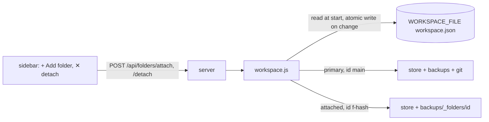

# Spec: workspace folders (several drawings roots in one sidebar)

## Goal
Like a VS Code multi-root workspace: besides the primary drawings folder (`DRAWINGS_DIR`, parent repo's `docs/drawings`), the user can attach more folders, each holding per-project subfolders (for example `<other repo>/docs/drawings`). The sidebar shows one section per folder. Folders are attached and detached in the UI, and the list is saved to a config file, so the hub reopens the same folders after a restart.

## Not building
- No git sync for attached folders. The ⟳ button stays on the primary folder only (it is tied to `REPO_DIR`). Next step if wanted: detect a folder's repo with `git rev-parse --show-toplevel` and give each folder its own `createGit`.
- No folder picker dialog. A browser cannot hand a server a local path, so the path is typed (absolute path, as `pwd` prints it).
- No reordering or renaming of folders. Order is attach order; the label is the repo name for `<repo>/docs/drawings`, otherwise the folder's own name (full path as tooltip).
- The primary folder cannot be detached: it comes from the environment, not from the config file.
- No moving drawings between folders.

## Design

- **Folder id**: `main` for the primary; `f-` + first 12 hex of sha256(real path) for attached ones. Stable across restarts, no counter in the file.
- **Config file** `WORKSPACE_FILE` (default `workspace/workspace.json` in the hub folder, gitignored): `{"version": 1, "folders": ["/abs/path", ...]}`. Written to a temp file then renamed. A missing file means no attached folders. An unreadable or invalid file is copied to `workspace.json.bad` and the hub starts with none (logged).
- **Where folders may be**: only under `FOLDERS_ROOT` (after `realpath`). Under Docker, compose bind-mounts `HUB_FOLDERS_ROOT` (default `$HOME`) at the same path inside the container, so a path typed in the UI means the same thing on the host and in the container. Natively `FOLDERS_ROOT` defaults to `$HOME`. Unset (unit tests, old setups): attaching is off and the button is hidden.
- **Attach checks**: absolute, a directory, real path under `FOLDERS_ROOT`, not the primary (same device + inode, so the Docker `/repo` mount is recognised under `$HOME` too), and not inside or containing the primary or another attached folder. An empty folder is fine. The same checks run on every entry of the config file at start: an entry that fails is logged and dropped, except a missing folder, which stays listed with its error. With `FOLDERS_ROOT` unset no saved folder is opened.
- **Config file safety**: written with fsync + rename. If it exists but cannot be read at start, attach/detach are refused so it is never written over.
- **Known limit**: the real path is checked at attach and at start. A folder that is later replaced by a symlink is followed until the next restart (needs someone else writing in your home; accepted).
- **Detach**: removes the folder from the list and the file only; files on disk are untouched. Refused (409) for the folder of the loaded drawing, so the baseline never points into a folder the hub no longer knows.
- **A folder that went missing** (unmounted drive, deleted repo) stays in the list and its section shows the error, so it can be detached. Other folders are listed normally.
- **API**: every drawing route takes `folder` (id; default `main`, so older callers work). `current` is `{folder, project, file}`. `GET /api/projects` returns `{folders: [{id, name, path, primary, sync, error?, projects}]}`. `GET /api/config` adds `canAttach`. New: `POST /api/folders/attach {path}`, `POST /api/folders/detach {id}`.
- **Backups**: primary unchanged (`BACKUPS_DIR/<project>/...`); attached folders use `BACKUPS_DIR/_folders/<id>/...`. Project names cannot start with `_`, so no collision.
- **Autosave on load with nothing loaded** still goes to the primary folder's `tmp/`.
- **UI**: sidebar section per folder (header: label, path as tooltip, ✕ on attached ones), projects inside as today. "+ Add folder" button at the top prompts for a path. The save form gets a folder select next to the project field; it follows the loaded drawing.

## Decisions
| Decision | Based on |
|---|---|
| Primary from env + attached from file, not all folders in the file | Keeps the current setup, git sync and tests as they are; nothing to migrate. |
| Hash ids instead of names or indexes | Two repos both have `docs/drawings`, so names collide; indexes shift on detach. A hash of the path is stable and needs no stored state. |
| Same-path bind mount of `$HOME` under Docker | Paths are the same on host and in the container, so the config file works for both runtimes. Trade-off: the container can write anywhere under that folder (it already writes parent repo). `HUB_FOLDERS_ROOT` narrows it, e.g. `~/repos`. |
| JSON file, own ~40 lines, no config library | One list of strings; `JSON.parse` plus an atomic rename is all it needs. |
| Refuse detaching the loaded drawing's folder | The simplest way to keep save/revert from targeting a folder outside the workspace. |
