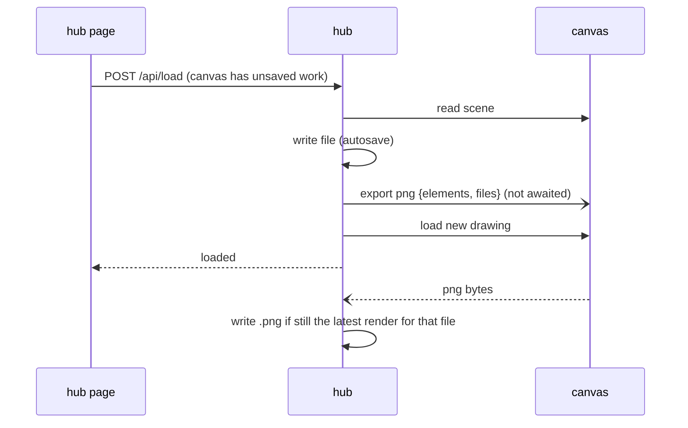

# PNG off the switch path

Status: draft 2026-11-19. Plan: [../plans/2026-11-19-png-off-the-switch-path.md](../plans/2026-11-19-png-off-the-switch-path.md). Extends "PNG on save" in [2026-11-02-excalidraw-hub.md](2026-11-02-excalidraw-hub.md).

## Problem
User report 2026-11-19: switching drawings is sometimes slow right after a save, or when the canvas has unsaved changes.

Measured on the isolated test stack over a copy of a real drawings folder (probe scripts are in the parent repo's `sandbox/tmp/hub-switch/`, which is not kept; numbers are recorded here):

| Case (529-element drawing, 9 images) | Time |
|---|---|
| Clean switch, click to painted in the hub UI | 0.20 s (small drawing) to 0.42 s |
| `POST /api/save`, no edits | 2.1 to 3.8 s |
| Canvas `POST /api/export/image` png alone | 1.9 to 2.5 s; svg alone 0.26 s; png without the image elements 1.5 s |
| Canvas `GET /api/elements` while an export runs | 1.67 s (the canvas event loop is blocked) |
| Switch with unsaved changes (autosave first) | 0.6 s (217 elements) to 2.0 s (529) |

- Every save, including the autosave before a load, waits for the PNG. Requests are serial, so a load clicked during a save waits for that PNG too.
- The PNG cost is resvg rasterizing on the canvas's main thread (`resvg.render()` is synchronous). Images and scale are not the cost.
- Ruled out: false "unsaved changes" after a save. With a browser tab connected, status stayed clean after a browser edit + Save and after an agent edit + Save, and the next switch did not autosave.

## Decisions
1. **The canvas rasterizes off its main thread.** `svgToPng` uses resvg's `renderAsync` (runs on the libuv thread pool). Based on: probe in the canvas container, main-loop lag 9 ms with `renderAsync` against the whole render time with `render()`, same PNG bytes.
2. **The canvas export can render a given scene.** `POST /api/export/image` takes optional `elements` and `files`; with them it renders that scene instead of the live canvas. Based on: a render that outlives the request must not read the live canvas, because the next load replaces it. Without this the background render would picture the next drawing.
   - A render of a given scene uses the node renderer only. Before, a failed node render fell back to an open browser tab. That fallback is gone for saves; a failure is reported instead. Accepted: the tab renders the live canvas, which is the wrong scene once a background render outlives the request.
3. **The hub renders the PNG in the background for the UI and the autosave.** The file is written, the save returns, and the PNG follows:
   - The scene sent is the saved document's elements and files, so the PNG matches the file.
   - The UI's save sends `png: "background"`. The autosave before a load and before a revert always uses it.
   - Other API callers keep the old behavior: the save waits and reports `png: true` or `pngError`. Based on: agents call `POST /api/save` and may read the PNG right after (README, `e2e/agent-save.spec.js`).
   - If the document's JSON is over 9 MB (the canvas accepts 10 MB), the hub renders as today, waiting, from the live canvas. Rare; correct.
4. **Latest render wins per file.** Each path has a generation counter. A render writes the PNG only if no newer render for that path started meanwhile.
5. **File operations wait for pending renders.** Rename, move, delete, revert, detach and sync wait until no PNG render is pending (sync re-checks, because saves can run during a sync). Rename, move, delete and detach also drop the old path's render state, so a stale error does not linger. Otherwise a late render would leave an orphan PNG at the old name, bring back a deleted PNG, or let sync commit a stale PNG. Load and save do not wait.
6. **Render failures still show.** `GET /api/status` reports `png: { pending, error }`, where `error` names the file and message of the last failed background render (cleared by the next success for that file). The page shows it in the message line when it first appears. The save message says "… (.png rendering)" instead of "and its .png".

## Not building
- A faster renderer or a lower PNG resolution: the cost is resvg itself, and the user wants a PNG on every save (spec 2026-11-19-standalone-workspace).
- Skipping re-upload of image files the canvas already holds on load: about 0.1 s of a 0.3 s clean switch; not the reported problem.
- A render worker or job queue in the canvas: `renderAsync` is enough.

## Flow

