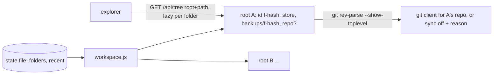
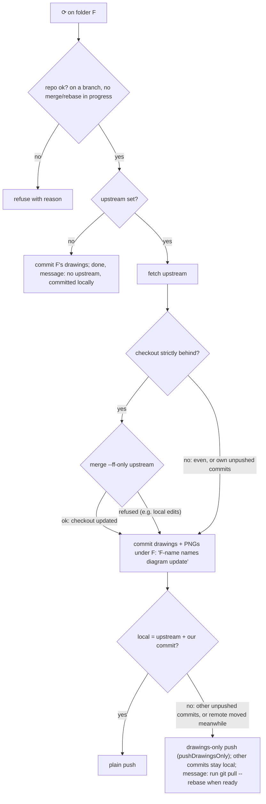

# Spec: standalone hub with a VS Code-style workspace

## Goal
Anyone can clone the hub from GitHub, follow the README alone, and run it natively or in Docker on ports of their choice. The sidebar works like the VS Code explorer:
- Attach any number of folders and they are remembered.
- Browse subfolders at any depth and drag drawings between folders.
- Resize the sidebar by dragging its right edge, or hide it.
- ⟳ on a folder that lives in a git repo commits its drawings in the user's checkout and pushes them.
- Existing features stay: load, save, save new version, PNG on save, revert, rename, delete, unsaved badge, agent save, code blocks.

The hub knows nothing about any parent repo. A personal setup is just one state file that lists its folders.

## Not building
- **Remote or multi-user hosting.** There is no auth, so both runtimes bind to loopback. Exposing the hub on a LAN is out of scope; `HUB_HOST` stays undocumented as a debug override.
- **A server-side folder picker dialog.** The browser cannot hand a local path to the server, so the path is typed. Recently detached folders are offered back in the prompt.
- **Moving folders.** Drag and drop moves drawings only. Folders are created in the explorer, not moved.
- **Showing other file types.** The explorer lists only `.excalidraw` files and folders. PNGs stay hidden but follow their drawing.
- **Rebase or autostash during sync.** Sync never rewrites local commits (see Sync).
- **Migrating other people's setups.** "No backward support": the old env vars and `workspace.json` v1 are simply not read. The maintainer's own setup is converted by hand in the cutover step of the plan.
- **The parent-side wrapper** proposed in the earlier standalone spec. It is not needed: the state file replaces it.

## Answers to the user's questions
- **Why several `mcp_excalidraw` containers?** Each Claude Code session starts its own stdio MCP server, and the parent repo's MCP script does that with `docker run -i --rm`. Three sessions therefore run three randomly named containers. They are harmless: they hold no state and all talk to the one canvas, and `--rm` removes each when its session exits cleanly. A crashed session can leave one behind. The fix is in "Agent MCP" below: the hub ships `scripts/mcp.sh`, which runs the MCP server inside the existing canvas container (`docker compose exec`) or as a native process, so no container is created per session. Probed 2026-11-19, from the hub folder: `docker compose exec -T -u 1000:1000 -e EXPRESS_SERVER_URL=http://127.0.0.1:3000 -e EXCALIDRAW_EXPORT_DIR=/tmp canvas node dist/index.js` answers `initialize` and `tools/list`, and `docker ps` shows the same 8 containers before and after. Writing an export into a mounted `FOLDERS_ROOT` is not probed yet; plan step 10 checks it.
- **Does sync use my checkout?** Yes. The folder you attach *is* your checkout; Docker bind-mounts it at the same path. ⟳ commits there and pushes from there, and when the remote is only ahead it fast-forwards your checkout too, so no manual pull is needed.

## Configuration: two files, split by who writes them
| File | Written by | Holds | Read by |
|---|---|---|---|
| `.env` (copy of `.env.example`, gitignored) | the user | Infrastructure fixed at start: `HUB_PORT` (3080), `CANVAS_PORT` (3000), `FOLDERS_ROOT` (default `$HOME`), `UID`/`GID`, `PLANTUML_URL`, `HUB_STATE` | `compose.yaml`, `scripts/native.sh`, `scripts/mcp.sh` |
| State file `HUB_STATE` (default `./config/hub.json`, gitignored) | the hub (UI actions) | `{"version": 2, "folders": [{"path": "/abs/path"}], "recent": ["/abs/path", ...]}` | hub server |

- Every hub setting is listed once, with its default, in `.env.example` and in a README table. Nothing else is configurable.
- Removed: `HUB_REPO`, `HUB_DRAWINGS_SUBDIR`, `DRAWINGS_DIR`, `REPO_DIR`, `SYNC_BRANCH`, `WORKSPACE_FILE`, and the `drawings/` default folder.
- View state (sidebar width, hidden or shown, expanded nodes, selected folder) is kept in the browser's `localStorage`, like VS Code's per-window layout. It is not sent to the server.
- The state file is written atomically (temp file, fsync, rename), as today. If it is unreadable, attach and detach are refused so it is never overwritten. If it is invalid, it is copied to `.bad` and the hub starts empty (today's rules, kept).
- A different personal setup is a different `HUB_STATE` path, e.g. a tracked file in another repo.

## Workspace model

- **Roots.** All folders are attached and equal; there is no primary. Zero folders is a valid state: the explorer then shows only "+ Add folder".
- **Root ids.** `f-` + 12 hex chars of sha256(real path), as today. Each root's backups live in `BACKUPS_DIR/<id>/<relative path>`.
- **Attach checks.** Kept from the workspace-folders spec:
  - The path is absolute, is a directory, and its real path is inside `FOLDERS_ROOT`.
  - It does not overlap another root.
  - "Not the primary" goes away, since there is no primary.
- **Recent.** Detaching a folder moves its path to the front of `recent` (at most 10 entries). The attach prompt lists the recent paths, so one can be picked again.
- **Repo detection** runs per root at attach time and at start: `git -C <root> rev-parse --show-toplevel`. Sync is on for that root when this succeeds and the top level is visible to the hub. Otherwise sync is off, and the root's tooltip shows git's own reason (from `repoTopLevel` in the standalone branch). A root that lies inside another root's repo gets its own git client for the same repo; commits go through one queue per repo.

## Explorer (sidebar)
- **Tree.** Each root is a top node. Children are listed when a node is expanded (`GET /api/tree?root=<id>&path=<rel>`), so a large repo is never scanned whole. A folder shows:
  - its subfolders, except dot-folders, `node_modules` and anything matched by `.gitignore`. Ignored folders are found with `git check-ignore` when the root is in a repo, otherwise only the fixed list applies;
  - its `.excalidraw` files.
- **Expand and collapse** by clicking a folder or its chevron. A "collapse all" button sits in the header. The expanded set is restored from `localStorage`.
- **Selection.** Clicking a folder selects it as the save target. Clicking a drawing loads it and selects its folder.
- **Hover actions:**
  - on a drawing: ✎ rename, 🗑 delete;
  - on a folder: ＋ new folder, ⟳ sync (repo roots only);
  - on a root: ✕ detach as well.
- **Drag and drop.** Drag a drawing onto any folder node, in the same or another root, to move it there (see Move). While dragging, the folder under the pointer is highlighted. A drop onto the drawing's own folder does nothing.
- **Resize.** A 4 px handle on the sidebar's right edge. Dragging it sets the width, clamped to 180 px … 60 % of the window. Double-clicking the handle resets it to 280 px. While dragging, a transparent overlay covers the iframe so the canvas does not swallow the mouse.
- **Hide.** A ☰ button in the header toggles the sidebar, as does `Ctrl+B` while focus is on the hub page; keys typed inside the canvas iframe go to the canvas. When hidden, the sidebar collapses to the button.

## Naming at any depth
Any folder at any depth can hold drawings. There is no "project = top-level folder" rule any more. Confirmed by the user on 2026-11-19 (option b).

- **Families.** Within one folder, the files `<stem>_v<i>[_<label>].excalidraw` with the same stem form one family. The stem is parsed lazily: `^(.+?)_v(\d{1,9})(?:_(.+))?$`.
- **Latest.** The highest `i` per stem is marked "latest". A folder can hold several families. Files without `_v<i>` are "unversioned" and are still listed, loadable and saveable.
- **The folder name is only the default stem for new drawings.** Saving with nothing loaded into the selected folder D uses `<basename D>`.
- **Save:**
  - With no label and a drawing loaded from D, it overwrites that drawing (unchanged safety checks).
  - Otherwise it writes `<stem>[_<label>].excalidraw` and refuses if that file exists. The stem is the loaded drawing's stem, or `<basename D>` when nothing is loaded or the loaded drawing is in another folder.
- **Save new version** writes `<stem>_v<next>[_<label>]` into D and never overwrites. The stem comes from the same rule. For an unversioned loaded drawing, its whole base name is the stem.
- **Unsafe stems.** If the stem would not be a safe name (`isSafeName`: letters, digits, `._-`), the save is refused with "pick a label-free name: rename the folder or the drawing". Loading still works.
- **Autosave on load when nothing was loaded** goes to `tmp/tmp_v<n>` inside the root of the drawing being loaded (today: the primary's `tmp/`).
- **PNG: unchanged.** Every save writes `<name>.png` next to the drawing. A rename, move or delete carries the `.png` along.
- The naming scheme is documented in the README, its only home.

## Move (drag and drop)
`POST /api/move {from: {root, path}, to: {root, dir}}`:
1. Refuse if the target already holds the file name or its `.png` (409), or if the target is not inside a root.
2. Rename the `.excalidraw` and then the `.png`. If the rename fails with `EXDEV` (another drive), copy, fsync and unlink instead.
3. Move that drawing's backups folder to the new place, so Revert history follows the drawing.
4. If the moved file is the loaded drawing, update `current`.

- The file name is kept, as in VS Code. Families are per folder and per stem, so a moved drawing joins or starts the family of its stem in the target folder. Moving `a_v3` into a folder that already has `a_v5` gives "latest" to `a_v5`.
- Moves run in the hub's serial queue, like every other file operation.

## Sync (⟳ on any folder of a repo root)

- **Branch.** Sync uses whatever branch the checkout is on and pushes to that branch's upstream. `SYNC_BRANCH` is gone.
  - `HUB_AUTO_SYNC_BRANCHES` in `.env` (comma-separated, default `development,dev`) lists the branches where ⟳ commits and pushes without asking.
  - On any other branch, ⟳ first asks "Commit and push `<F>` on branch `<b>`?". This is today's confirm, generalized; the user chose it on 2026-11-19.
  - The user's rule: other sessions keep their own branches and rebase later; drawings are almost never touched on those branches.
- **Scope.** Only `*.excalidraw` and `*.png` under the clicked folder are staged. Today the whole folder is staged; this is narrowed because the explorer shows nothing else, so nothing invisible gets committed.
- **Updating the local checkout.** Fetch first. If the checkout is strictly behind its upstream, `git merge --ff-only @{u}` brings it up to date before the commit, so the commit then goes up as a plain push and no manual pull is needed. If git refuses (for example, local edits would be overwritten), sync still commits and sends only the drawings commit up (`pushDrawingsOnly`), and the message says the checkout was not updated and why. A failed pull never blocks saving the drawings to the remote. With unpushed commits of its own, the checkout is left as is and only the drawings commit goes up (today's `pushDrawingsOnly`). The same happens when the remote moved between the fetch and the push. Rebase and autostash are never used: they would rewrite commits or move a branch under another session.
- **Error handling, queueing, timeouts, no prompts (`BatchMode`) and the cherry-pick conflict rule** stay as in the current `git.js`.

## Hosting
| | Native | Docker |
|---|---|---|
| Start | `scripts/native.sh install` once, then `start` / `stop` / `status` / `restart` | `docker compose up -d --build`; `down` stops it |
| Needs | Node 20+, git | Docker with compose v2 |
| Ports | `HUB_PORT`, `CANVAS_PORT` from `.env` | same; `127.0.0.1:${CANVAS_PORT}:3000` and `127.0.0.1:${HUB_PORT}:${HUB_PORT}` |
| Which folders can be attached | anything inside `FOLDERS_ROOT` (default `$HOME`) | only `FOLDERS_ROOT`, bind-mounted at the same path in hub and canvas (canvas: for MCP file export) |
| Git identity | the user's own | `~/.gitconfig` and `~/.ssh` mounted read-only (key without passphrase), as today |
| Starts at boot | no | yes (`restart: unless-stopped`) |

- **Boot-race guard.** Under Docker, Desktop can start containers before the WSL bind mount is connected. The guard moves from "primary folder empty" to "`FOLDERS_ROOT` empty or unreadable → exit", and only compose turns it on (`HUB_WAIT_FOR_MOUNT=1`). Natively an empty or missing root is shown in the explorer instead.
- **Busy port.** Both runtimes fail on a busy port; they never pick another. The MCP and the iframe must agree on the canvas port.
- **Compose project name.** It comes from the clone's folder name, so two clones on different ports can run side by side. This matters for the install check.

## Agent MCP (`scripts/mcp.sh`)
- Register it once with `claude mcp add excalidraw -- <clone>/scripts/mcp.sh`, or put the same command in a project's `.mcp.json`. The README shows both.
- The script reads `.env` from its own folder, not from `$PWD`.
- If the compose `canvas` service is running (`docker compose -f <clone>/compose.yaml ps -q canvas`), the script runs:
  `exec docker compose -f <clone>/compose.yaml exec -T -u $(id -u):$(id -g) -e EXPRESS_SERVER_URL=http://127.0.0.1:3000 -e EXCALIDRAW_EXPORT_DIR=$FOLDERS_ROOT canvas node dist/index.js`
  It never calls `docker run`, so no container is created per session.
- Otherwise, if the native build exists, it runs `exec node <clone>/canvas/dist/index.js` with `EXPRESS_SERVER_URL=http://127.0.0.1:$CANVAS_PORT`.
- Otherwise it exits with "start the hub first (README, Run)".
- The script refuses to run from a `/mnt/*` (Windows) path, as the parent's script does today.

## Cleanup for a public repo
- `git grep -i <former parent name>` must print nothing. It already does on the standalone base branch; the gate is re-run at the end.
- `fixtures/` holds copies of the maintainer's real drawings, including a photo. Replace them with made-up drawings that cover the same cases (versioned, unversioned, image element, PNG pair, nested folders), and update the tests that name them.
- README rewrite:
  - What it is.
  - Install: native and Docker, from `git clone`.
  - Configure: the `.env` table and the state file.
  - Use: the explorer, naming, sync.
  - Agent MCP.
  - Test.
  - Limits.
  - Screenshots regenerated by `scripts/screenshots.sh`.

## History rewrite (user's decision 2026-11-19)
The public history holds the maintainer's real drawings, including a photo, in `fixtures/` (11 paths, listed by `git log --all --name-only -- fixtures`), plus 19 commits whose diffs and 1 commit message name the former parent repo, and 1 commit with a personal home path.
- **Tool:** [git-filter-repo](https://github.com/newren/git-filter-repo), the tool the git project recommends over `filter-branch`, run with `uvx git-filter-repo`.
  - `--invert-paths` with every old fixture path.
  - `--replace-text` and `--replace-message` with one expressions file: the parent repo's name becomes `parent repo`, and the maintainer's home path becomes `/home/me`.
- **Order:** last, after the branch is squash-merged into `development`, so one rewrite covers everything. Run it on a fresh `--mirror` clone. Keep a bundle of the pre-rewrite repo outside the repo (`git bundle create`) for rollback.
- **Gate before publishing:** in the rewritten mirror, `git log --all -p | grep -ci <parent name>` and the home path both print 0, and no old fixture path exists in any commit.
- **Why a force-push is not enough:** GitHub keeps `refs/pull/<n>/head` for PRs #1–#4, and those cannot be deleted, so the old commits, including the photo, stay reachable by SHA. A complete purge means deleting and recreating the GitHub repo (0 stars, 0 forks on 2026-11-19; the 4 PR pages are lost), then pushing the rewritten `development` and setting it as default. Pending the user's choice: delete and recreate, or force-push only.
- **Side effects:**
  - Every SHA changes. Old parent-repo commits pin hub SHAs that will no longer exist on GitHub, so checking out an old parent commit no longer finds its hub commit. Only the new bump commit works.
  - Other clones and worktrees of the hub must be re-cloned. Today that means the parent's submodule checkout and this worktree.
  - The `canvas/` subtree history is rewritten too. Later `git subtree pull` keeps working because it uses `--squash`.

## API (all drawing routes)
- A drawing is identified by `{root, path}`, where `path` is relative to the root (POSIX separators). `current` becomes `{root, path}`.
- Every path is resolved inside its root, and its real path must stay inside the root (no `..`, no symlink escape). Unsafe paths are refused with 400.

| Route | Change |
|---|---|
| `GET /api/tree?root&path` | new: `{dirs: [{name, path}], drawings: [{file, path, base, version, label, latest, backups}]}` |
| `GET /api/folders` | replaces `GET /api/projects`: `[{id, name, path, sync, syncError?, error?}]` |
| `POST /api/folders/attach {path}`, `/detach {id}` | kept; detach adds the path to `recent` |
| `GET /api/config` | `{canvasUrl, canAttach, recent}` |
| `POST /api/mkdir {root, path}` | new |
| `POST /api/move` | new (see Move) |
| `load`, `save`, `revert`, `rename`, `delete` | take `{root, path}`; `save` takes `{root, dir, label, versioned}` |
| `POST /api/sync {root, path}` | the folder to sync; no `confirm` |

## Supersedes
| Earlier decision | Spec | Now |
|---|---|---|
| Settings stay env vars, no config file of our own | standalone (2026-11-16) | `.env` for infrastructure plus a hub-written state file for folders |
| `HUB_REPO=./drawings`, `HUB_DRAWINGS_SUBDIR`, `SYNC_BRANCH=main`, parent wrapper | standalone | removed; folders come from the state file; sync uses the current branch |
| Primary folder from env, never detached, the only one with sync | workspace-folders (2026-11-16) | no primary; any root inside a git repo gets sync |
| No moving drawings between folders | workspace-folders | drag and drop moves them |
| Project = first-level folder, drawings one level deep | main spec (2026-11-02) | any depth; the stem is the drawing's own folder name |
| Sync pushes only from `SYNC_BRANCH`, confirm otherwise | main spec | current branch and its upstream, then fast-forward the checkout |
| Boot guard on the primary folder | main spec, "Boot race" | guard on `FOLDERS_ROOT`, Docker only |
| Agents' MCP server via `docker run` per session (parent repo script) | (parent repo) | hub's `scripts/mcp.sh` execs into the canvas, or runs natively |

## Decisions
| Decision | Based on |
|---|---|
| Two config files (`.env` plus a state file), not one | Compose reads ports and mounts only from env/`.env` at `up` time; the folder list changes at runtime from the UI. One file per writer keeps the hub from editing a file the user hand-edits. |
| State file JSON, own code, no config library | It holds one list plus `recent`; `JSON.parse` and an atomic rename are enough (existing ~40 lines). |
| View state in `localStorage` | It is per browser, changes on every drag, and needs no server writes; VS Code keeps layout per window the same way. |
| Lazy tree listing per expanded folder | A repo root can be large (`node_modules`); listing only what is open scales with what is visible. |
| Families by stem per folder; folder name is only the default stem | User's answer 2026-11-19 (option b), after being shown both readings. |
| Keep the file name on move | VS Code behaviour; a silent rename would surprise. The user can rename afterwards. |
| Auto-sync only on `HUB_AUTO_SYNC_BRANCHES` (default `development,dev`), ask elsewhere | User's answer 2026-11-19. It sits in `.env` because the user sets it, not the UI. |
| Sync on the current branch, ff-only update, never rebase | User's answer 2026-11-19: commit in the local checkout and push; other sessions keep their branches. Rebase or autostash would rewrite commits or move a branch under another session. |
| Stage only `*.excalidraw` and `*.png` | The explorer shows only drawings; committing files the user cannot see would be a surprise. |
| PNG on every save, unchanged | User's answer 2026-11-19: keep as is. |
| MCP via `docker compose exec` into the canvas | Probed 2026-11-19: it works and creates no container. `compose exec` with `-f` finds the container by service name, so a clone in any folder works (a fixed container name would block two clones). |
| Mount `FOLDERS_ROOT` into the canvas too | The MCP's file export must write where the user's drawings are, as the per-session container did. Trade-off: the canvas container can write in that folder too; narrow it with `FOLDERS_ROOT`. |
| Loopback only, no auth | Same threat model as today (Host-header allowlist); multi-user hosting is not asked for. |
| Build on `feat/standalone`, not `development` | That branch already removed parent references and added `repoTopLevel`; its env-only and primary-folder decisions are superseded above. |
